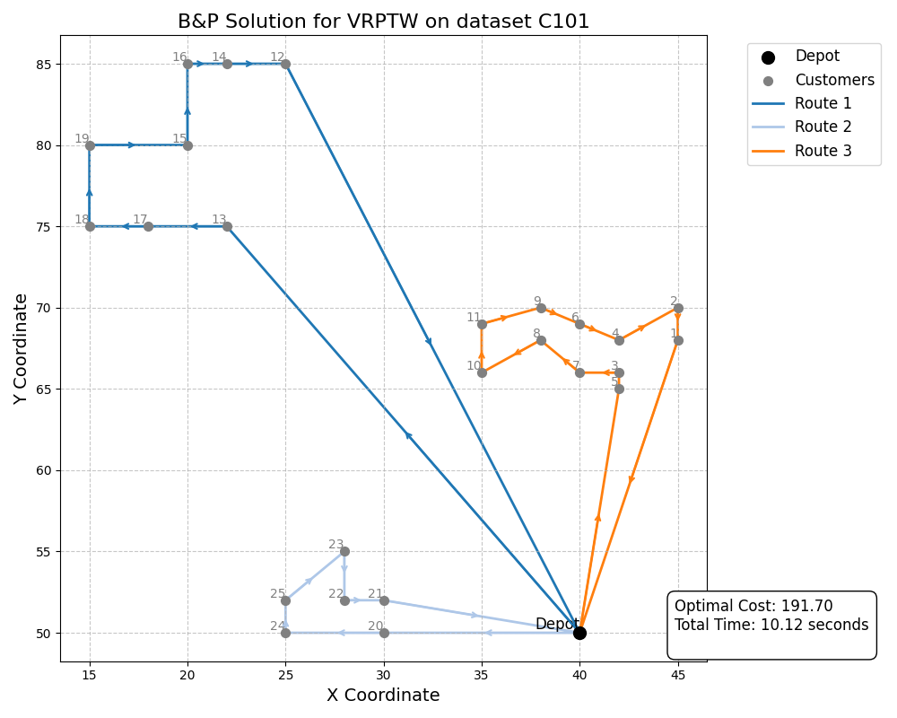

# bpvrptw — Branch-and-Price for VRPTW

[](https://github.com/Guard42/A-Branch-and-Price-Algorithm-for-VRPTW/actions/workflows/ci.yml)
[](pyproject.toml)
[](LICENSE)
[](pyproject.toml)

An **exact** branch-and-price solver for the Vehicle Routing Problem with
Time Windows, packaged as a proper Python library — typed API, dual LP
backends, bounded resources, and a test suite that verifies optimality
against brute force.



> **一句话简介**：这是仓库初版（对 Java 项目 dengfaheng/BPVRPTW 的 AI 移植）
> 的库级重写：类型化 API、HiGHS/Gurobi 双后端、有界资源、暴力对拍测试。
> 旧实现按字节原样封存在 [`legacy/`](legacy/README.md)，作为反面教材与学习笔记。
> 算法细节见 [docs/algorithm.md](docs/algorithm.md)。

## What is this?

Branch-and-price = column generation (pricing out routes with negative
reduced cost) embedded in branch-and-bound (branching on fractional edges).
It solves VRPTW *to proven optimality* on small-to-medium instances. The
implementation follows the classical Desaulniers/Solomon framework; the
legacy code this repo started from is preserved under `legacy/` together
with a defect catalogue (D1–D9) that every design decision here fixes.

## Features

- **Typed public API** (`py.typed`): `VRPTWInstance`, `Route`, `Solution`,
  `BranchAndPrice`, `ESPPRCSolver`, … with JSON round-tripping.
- **Dual LP backends**, one interface: [HiGHS](https://highs.dev) by default
  (Apache/MIT, license-free, CI-friendly); Gurobi optional via `[gurobi]`.
- **Warm-started incremental RMP**: one persistent model per search node,
  columns appended in place — no rebuild-per-iteration.
- **Best-first bounded ESPPRC pricing** with Feillet-style pruning; hard
  caps degrade gracefully instead of hanging.
- **Deterministic** results: fixed iteration orders, seeded solvers,
  single-threaded LP.
- **Verified**: pricing soundness + optimal minimum cross-checked against
  brute-force enumeration; branch-and-price matched against an exact DP on
  tiny instances; C101_25 reproduces the known optimum with certificate.
- **CLI & harness**: `python -m bpvrptw solve|bench`, JSON/CSV outputs,
  headless plotting.

## Installation

```bash
git clone https://github.com/Guard42/A-Branch-and-Price-Algorithm-for-VRPTW
cd A-Branch-and-Price-Algorithm-for-VRPTW
pip install -e .            # core (numpy + highspy only)
pip install -e ".[plot]"    # + matplotlib for figures
pip install -e ".[gurobi]"  # + optional Gurobi backend (needs a license)
pip install -e ".[dev,plot]"  # everything for developing
```

Gurobi is entirely optional: the RMP here is a small LP and HiGHS does it
just as well without a license. See the FAQ below for why we do not embed
column generation into Gurobi callbacks.

## Quickstart

CLI:

```bash
python -m bpvrptw solve dataset/C101_25.txt --time-limit 300 --output-json result.json --save-fig solution.png
python -m bpvrptw bench dataset --time-limit 45 --json bench.json --csv bench.csv
```

Python API:

```python runnable
import tempfile
from pathlib import Path

import bpvrptw
from tests.conftest import write_solomon, TINY_DEPOT, TINY_CUSTOMERS

tmp = Path(tempfile.mkdtemp())
path = write_solomon(tmp, "DEMO", vehicle_count=4, capacity=100.0,
                     depot_row=TINY_DEPOT, customers_rows=TINY_CUSTOMERS[:3])

solution = bpvrptw.solve(path, time_limit_seconds=60)
print(solution.status.value, f"{solution.total_cost:.2f}",
      f"{len(solution.routes)} routes")
assert solution.status == bpvrptw.SolutionStatus.SOLVED_OPTIMAL
```

Lower-level control:

```python runnable
import tempfile
from pathlib import Path

from bpvrptw import BranchAndPrice, VRPTWInstance
from tests.conftest import write_solomon, TINY_DEPOT, TINY_CUSTOMERS

tmp = Path(tempfile.mkdtemp())
path = write_solomon(tmp, "DEMO2", vehicle_count=4, capacity=100.0,
                     depot_row=TINY_DEPOT, customers_rows=TINY_CUSTOMERS[:4])
instance = VRPTWInstance.from_solomon(path)

solver = BranchAndPrice(instance, lp_solver="highs", time_limit_seconds=120)
solution = solver.solve()
for route in solution.routes:
    print(route.path, round(route.cost, 2))
```

## How the algorithm works

The master problem is a set-partitioning LP over feasible routes; column
generation prices new routes by solving an ESPPRC with a labeling
algorithm (dominance rule, Feillet pruning, best-first ordering); the
branch-and-bound tree branches on fractional edges when the LP solution is
integral-infeasible. Full walkthrough with the mathematics:
**[docs/algorithm.md](docs/algorithm.md)**.

## Benchmarks

Measured on the bundled Solomon subset (most files are 25-customer
truncations; full methodology in
[docs/benchmarks.md](docs/benchmarks.md)). **Gap** =
`(cost − lower_bound) / |cost| × 100`, shown only when the solver holds a
sound lower bound from fully converged column generation — never a fake
zero. `OPTIMAL` rows carry a closed-gap certificate.

<!-- BENCH_SUMMARY_START -->
| Tier | Instances | Proven optimal | Honest time limits |
|------|----------:|---------------:|-------------------:|
| 45 s sweep | 58 | 27 | 31 |
| 300 s deep | 12 selected | see table | see table |
<!-- BENCH_SUMMARY_END -->

Per-instance results (auto-generated, do not edit by hand):

<!-- BENCH_TABLE_START -->
| Instance | Status | Cost | Routes | Lower bound | Gap (%) | Time (s) |
|----------|--------|------:|-------:|------------:|--------:|---------:|
| `C101_25.txt` | **OPTIMAL** | 191.70 | 3 | 191.70 | 0.000 | 0.7 |
| `C102.txt` | **OPTIMAL** | 190.60 | 3 | 190.60 | 0.000 | 17.9 |
| `C103.txt` | time limit | 1132.40 | 25 | - | - | 300.1 |
| `C104.txt` | time limit | 1132.40 | 25 | - | - | 300.1 |
| `C105.txt` | **OPTIMAL** | 191.70 | 3 | 191.70 | 0.000 | 0.6 |
| `C106.txt` | **OPTIMAL** | 191.70 | 3 | 191.70 | 0.000 | 0.5 |
| `C107.txt` | **OPTIMAL** | 191.70 | 3 | 191.70 | 0.000 | 1.0 |
| `C108.txt` | **OPTIMAL** | 191.70 | 3 | 191.70 | 0.000 | 2.1 |
| `C109.txt` | **OPTIMAL** | 191.70 | 3 | 191.70 | 0.000 | 8.6 |
| `C110_1.TXT` | time limit | 402788.00 | 1000 | - | - | 45.1 |
| `C201.txt` | **OPTIMAL** | 215.60 | 2 | 215.60 | 0.000 | 1.6 |
| `C202.txt` | time limit | 1275.40 | 25 | - | - | 300.1 |
| `C203.txt` | time limit | 1275.40 | 25 | - | - | 45.0 |
| `C204.txt` | time limit | 1275.40 | 25 | - | - | 45.0 |
| `C205.txt` | **OPTIMAL** | 215.60 | 2 | 215.60 | 0.000 | 5.8 |
| `C206.txt` | **OPTIMAL** | 215.60 | 2 | 215.60 | 0.000 | 8.9 |
| `C207.txt` | time limit | 1275.40 | 25 | - | - | 45.0 |
| `C208.txt` | **OPTIMAL** | 215.40 | 2 | 215.40 | 0.000 | 89.7 |
| `R101.txt` | **OPTIMAL** | 618.10 | 8 | 618.10 | 0.000 | 0.0 |
| `R102.txt` | **OPTIMAL** | 547.90 | 7 | 547.90 | 0.000 | 82.5 |
| `R103.txt` | **OPTIMAL** | 455.60 | 5 | 455.60 | 0.000 | 2.3 |
| `R104.txt` | **OPTIMAL** | 418.00 | 4 | 418.00 | 0.000 | 14.2 |
| `R105.txt` | **OPTIMAL** | 531.30 | 6 | 531.30 | 0.000 | 0.1 |
| `R106.txt` | time limit | 1245.80 | 25 | 458.20 | 63.220 | 300.2 |
| `R107.txt` | **OPTIMAL** | 425.30 | 4 | 425.30 | 0.000 | 4.3 |
| `R108.txt` | time limit | 1245.80 | 25 | 397.79 | 68.069 | 45.1 |
| `R109.txt` | **OPTIMAL** | 442.70 | 5 | 442.70 | 0.000 | 0.4 |
| `R110.txt` | time limit | 1245.80 | 25 | 439.38 | 64.731 | 45.0 |
| `R111.txt` | time limit | 1245.80 | 25 | 428.26 | 65.624 | 45.0 |
| `R112.txt` | time limit | 1245.80 | 25 | 388.15 | 68.843 | 45.1 |
| `R201.txt` | time limit | 1245.80 | 25 | 461.30 | 62.972 | 300.1 |
| `R202.txt` | time limit | 1245.80 | 25 | - | - | 45.0 |
| `R203.txt` | time limit | 1245.80 | 25 | - | - | 45.1 |
| `R204.txt` | time limit | 1245.80 | 25 | - | - | 45.0 |
| `R205.txt` | time limit | 1245.80 | 25 | - | - | 45.0 |
| `R206.txt` | time limit | 1245.80 | 25 | - | - | 45.0 |
| `R207.txt` | time limit | 1245.80 | 25 | - | - | 300.1 |
| `R208.txt` | time limit | 1245.80 | 25 | - | - | 45.0 |
| `R209.txt` | time limit | 1245.80 | 25 | - | - | 45.0 |
| `R210.txt` | time limit | 1245.80 | 25 | - | - | 45.0 |
| `R211.txt` | time limit | 1245.80 | 25 | - | - | 45.0 |
| `RC101.txt` | time limit | 1887.00 | 25 | 409.38 | 78.306 | 45.0 |
| `RC102.txt` | **OPTIMAL** | 352.90 | 3 | 352.90 | 0.000 | 0.6 |
| `RC103.txt` | **OPTIMAL** | 334.20 | 3 | 334.20 | 0.000 | 3.3 |
| `RC104.txt` | **OPTIMAL** | 307.20 | 3 | 307.20 | 0.000 | 16.9 |
| `RC105.txt` | **OPTIMAL** | 412.40 | 4 | 412.40 | 0.000 | 0.5 |
| `RC106.txt` | **OPTIMAL** | 346.60 | 3 | 346.60 | 0.000 | 0.4 |
| `RC107.txt` | **OPTIMAL** | 299.10 | 3 | 299.10 | 0.000 | 2.2 |
| `RC108.txt` | **OPTIMAL** | 295.00 | 3 | 295.00 | 0.000 | 8.2 |
| `RC201.txt` | **OPTIMAL** | 361.40 | 3 | 361.40 | 0.000 | 2.3 |
| `RC202.txt` | time limit | 1887.00 | 25 | - | - | 300.0 |
| `RC203.txt` | time limit | 1887.00 | 25 | - | - | 45.0 |
| `RC204.txt` | time limit | 1887.00 | 25 | - | - | 45.0 |
| `RC205.txt` | **OPTIMAL** | 339.10 | 3 | 339.10 | 0.000 | 213.9 |
| `RC206.txt` | time limit | 1887.00 | 25 | - | - | 45.0 |
| `RC207.txt` | time limit | 1887.00 | 25 | - | - | 300.2 |
| `RC208.txt` | time limit | 1887.00 | 25 | - | - | 300.1 |
| `c101.txt` | time limit | 5770.80 | 100 | - | - | 45.0 |
<!-- BENCH_TABLE_END -->

Highlights: every C-family 25-customer instance → 191.7 / 215.6 proven
optimal; `c104` — the instance that hung forever in the legacy port — now
returns its incumbent cleanly inside its budget.

## Fixes over the original port

The initial version of this repo translated dengfaheng/BPVRPTW from Java;
the translation introduced (and inherited) real defects. All of them are
catalogued in [`legacy/README.md`](legacy/README.md) and fixed here:

| ID | Legacy behaviour | Now |
|----|------------------|-----|
| D1/D9 | Labels processed/selected in insertion order | Best-first by reduced cost; most-negative columns first |
| D2 | Dead comparator with undefined names (`A`/`B`) | No comparator; deterministic heap keys |
| D3 | Imposing an arc into the depot blocked all other routes' returns | End-depot semantics unit-tested |
| D4 | Whole Gurobi model deleted/rebuilt every CG iteration | Incremental columns, warm start retained |
| D5 | Branching score indexed routes by vertex id | Ryan-Foster-style fractional-closeness score |
| D6 | Prints everywhere, exceptions swallowed | Logging + typed errors |
| D7 | Hardcoded absolute paths | None anywhere |
| D8 | Unbounded loops → c104 hang | Bounded labels/time, graceful TIME_LIMIT |

## Project layout

```
bpvrptw/            the library (instance, labeling, rmp, column_generation,
                    branch_and_price, visualization, cli)
tests/              pytest suite incl. brute-force references
scripts/            benchmark harness and report checks
docs/               algorithm walkthrough + benchmark report
dataset/            Solomon instances bundled with this repo
results/            committed benchmark outputs (JSON/CSV)
legacy/             the original flat implementation, byte-identical,
                    with its defect catalogue — do not develop there
fig/                example solution figures
```

## FAQ

**Why not implement column generation inside Gurobi/CPLEX callbacks?**
Because you cannot: callbacks do not re-enter a node after columns are
added, MIP trees reject mid-search column additions, and node bounds are
not manually controllable. The standard architecture — used by RouteOpt
and the generic branch-cut-and-price literature — is to own the tree
yourself and use the solver purely as an LP oracle. That is exactly what
`BranchAndPrice` + `rmp.py` do; swapping HiGHS for Gurobi changes nothing
else.

**Why is Gurobi not the default?**
No philosophical objection — the RMP is a small LP and both backends pass
identical dual-convention tests. HiGHS simply keeps `pip install -e .`
license-free so anyone can clone, run the tests and get green CI.

**What about SCIP?**
SCIP genuinely supports pricing plugins and is the flexible option if you
want the solver to drive the tree. For an educational Python library that
is heavy machinery; the hand-written tree here is the teaching point.

**Didn't c104 hang forever?**
In the legacy port, yes (unbounded loops). Pricing now carries label/time
caps and BP threads its deadline into every subproblem; c104 terminates
with its incumbent and an honest TIME_LIMIT row in the benchmarks.

**Can I use this for research?**
It is an educational implementation: correctness-first, readability over
throughput. For research-grade exact VRP solving see RouteOpt or the
generic branch-cut-and-price framework of Pessoa et al.; you will want
C++ pricing, ng-routes and dual stabilization.

## Contributing

```bash
pip install -e ".[dev,plot]"
python -m ruff check .
python -m pytest -q
```

Please keep commits conventional (`feat:`, `fix:`, `docs:`, …), keep
`legacy/` untouched, and add tests for behavioural changes. The referees
that matter: ruff clean, full pytest green, README snippets runnable.

## Acknowledgements

- [dengfaheng/BPVRPTW](https://github.com/dengfaheng/BPVRPTW) — the Java
  original this project was ported from (itself following M. Schyns'
  educational implementation and the book 《运筹优化常用模型、算法及案例实战——Python+Java实现》).
- [Solomon's VRPTW benchmarks](https://w.cba.neu.edu/~msolomon/problems.htm).
- The zhihu ESPPRC article series (linked from the legacy README) that
  accompanied the original learning effort.

## License

GPL-3.0-or-later — same as the upstream work this project derives from.
