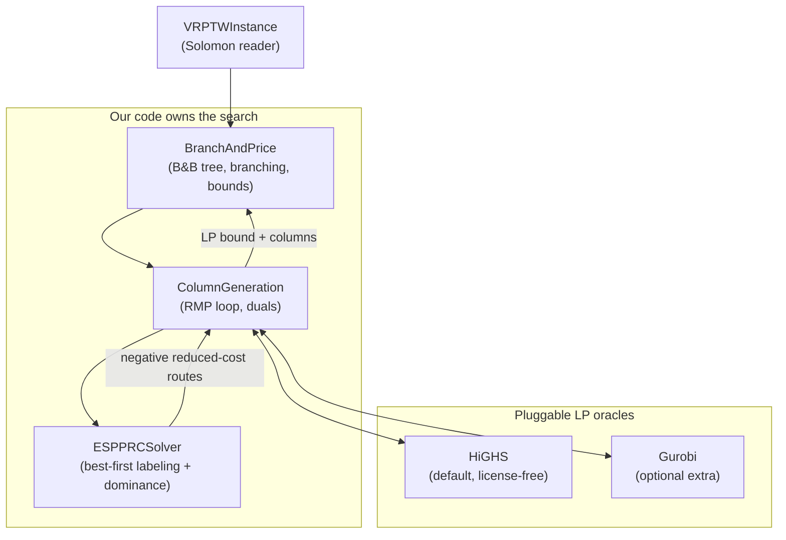

# bpvrptw — Branch-and-Price for VRPTW

[](https://github.com/Guard42/A-Branch-and-Price-Algorithm-for-VRPTW/actions/workflows/ci.yml)
[](pyproject.toml)
[](LICENSE)
[](pyproject.toml)

An **exact** branch-and-price solver for the Vehicle Routing Problem with
Time Windows, packaged as a proper Python library — typed API, dual LP
backends, bounded resources, and a test suite that verifies optimality
against brute force. A dependency-free C++17 twin of the same algorithm
lives under [`cpp/`](cpp/README.md).


> **一句话简介**：这是仓库初版的库级重写：类型化 API、HiGHS/Gurobi 双后端、
> 有界资源、暴力对拍测试。
> 旧实现按字节原样封存在 [`legacy/`](legacy/README.md)，作为反面教材与学习笔记。
> 算法细节见 [docs/algorithm.md](docs/algorithm.md)。

## Contact

If you have any questions regarding this repository, feel free to reach out.
Author: Junwei Li ([junweilee@njust.edu.cn](mailto:junweilee@njust.edu.cn))

## Updates

* August 2026: library-grade rewrite — the `bpvrptw` package, HiGHS/Gurobi
  dual backends, bounded pricing, a CLI, and a full measured benchmark
  suite (see Benchmarks below).
* March 14, 2025: Upload code and data for the B&P algorithm to solve VRPTW.

## What is this?

Branch-and-price = column generation (pricing out routes with negative
reduced cost) embedded in branch-and-bound (branching on fractional edges).
It solves VRPTW *to proven optimality* on small-to-medium instances. The
implementation follows the classical Desaulniers/Solomon framework; the
legacy code this repo started from is preserved under `legacy/` together
with a defect catalogue (D1–D9) that every design decision here fixes.




- **Typed public API** (`py.typed`): `VRPTWInstance`, `Route`, `Solution`,
  `BranchAndPrice`, `ESPPRCSolver`, … with JSON round-tripping.
- **Dual LP backends**, one interface: [HiGHS](https://highs.dev) by default
  (Apache/MIT, license-free, CI-friendly); Gurobi optional via `[gurobi]`.
- **Warm-started incremental RMP**: one persistent model per search node,
  columns appended in place — no rebuild-per-iteration.
- **Best-first bounded ESPPRC pricing** with Feillet-style pruning; hard
  caps degrade gracefully instead of hanging.
- **Deterministic** results: fixed iteration orders, seeded solvers,
  single-threaded LP.
- **Verified**: pricing soundness + optimal minimum cross-checked against
  brute-force enumeration; branch-and-price matched against an exact DP on
  tiny instances; C101_25 reproduces the known optimum with certificate.
- **CLI & harness**: `python -m bpvrptw solve|bench|check`, JSON/CSV outputs,
  headless spatial routes + Gantt schedule plotting.
- **C++17 twin implementation** ([`cpp/`](cpp/README.md)): the same
  branch-and-price algorithm compiled, with a built-in simplex replacing
  the external LP backends — no Python environment, no solver, no license.

## Installation

```bash
git clone https://github.com/Guard42/A-Branch-and-Price-Algorithm-for-VRPTW
cd A-Branch-and-Price-Algorithm-for-VRPTW
pip install -e .            # core (numpy + highspy only)
pip install -e ".[plot]"    # + matplotlib for figures
pip install -e ".[gurobi]"  # + optional Gurobi backend (needs a license)
pip install -e ".[dev,plot]"  # everything for developing
```

Gurobi is entirely optional: the RMP here is a small LP and HiGHS does it
just as well without a license. See the FAQ below for why we do not embed
column generation into Gurobi callbacks.

## Quickstart

CLI:

```bash
python -m bpvrptw solve dataset/C101_25.txt --time-limit 300 --output-json result.json --save-fig solution.png
python -m bpvrptw check dataset/C101_25.txt     # validate an instance
python -m bpvrptw bench dataset --time-limit 45 --json bench.json --csv bench.csv
```


Python API:

```python runnable
import tempfile
from pathlib import Path

import bpvrptw
from tests.conftest import write_solomon, TINY_DEPOT, TINY_CUSTOMERS

tmp = Path(tempfile.mkdtemp())
path = write_solomon(tmp, "DEMO", vehicle_count=4, capacity=100.0,
                     depot_row=TINY_DEPOT, customers_rows=TINY_CUSTOMERS[:3])

solution = bpvrptw.solve(path, time_limit_seconds=60)
print(solution.status.value, f"{solution.total_cost:.2f}",
      f"{len(solution.routes)} routes")
assert solution.status == bpvrptw.SolutionStatus.SOLVED_OPTIMAL
```

Lower-level control:

```python runnable
import tempfile
from pathlib import Path

from bpvrptw import BranchAndPrice, VRPTWInstance
from tests.conftest import write_solomon, TINY_DEPOT, TINY_CUSTOMERS

tmp = Path(tempfile.mkdtemp())
path = write_solomon(tmp, "DEMO2", vehicle_count=4, capacity=100.0,
                     depot_row=TINY_DEPOT, customers_rows=TINY_CUSTOMERS[:4])
instance = VRPTWInstance.from_solomon(path)

solver = BranchAndPrice(instance, lp_solver="highs", time_limit_seconds=120)
solution = solver.solve()
for route in solution.routes:
    print(route.path, round(route.cost, 2))
```

## How the algorithm works

The master problem is a set-partitioning LP over feasible routes; column
generation prices new routes by solving an ESPPRC with a labeling
algorithm (dominance rule, Feillet pruning, best-first ordering); the
branch-and-bound tree branches on fractional edges when the LP solution is
integral-infeasible. Full walkthrough with the mathematics:
**[docs/algorithm.md](docs/algorithm.md)**.

## Dataset

The algorithm has been benchmarked using the
[Solomon dataset](https://w.cba.neu.edu/~msolomon/problems.htm), a widely
recognized set of instances in the field of vehicle routing problems. It
was introduced by Marius Solomon in 1987 and comprises 56 instances with
100 customers each, categorized by customer distribution and scheduling
horizon into six types:

1. **C-Type (Clustered Customers)**
   - **C1:** clustered customer locations with narrow time windows and
     small vehicle capacities, leading to solutions with more routes and
     fewer customers per route.
   - **C2:** similar to C1 but with larger time windows and vehicle
     capacities, resulting in fewer routes with more customers per route.

2. **R-Type (Randomly Distributed Customers)**
   - **R1:** randomly distributed customers with narrow time windows and
     small vehicle capacities — more routes, fewer customers per route.
   - **R2:** similar to R1 but with larger time windows and vehicle
     capacities — fewer routes, more customers per route.

3. **RC-Type (Mixed Distribution of Customers)**
   - **RC1:** combines clustered and randomly distributed customers with
     narrow time windows and small vehicle capacities.
   - **RC2:** similar to RC1 but with larger time windows and vehicle
     capacities.

Each instance file is named to reflect its category, e.g. `c101.txt` is a
C1-type instance while `r201.txt` corresponds to an R2-type instance. The
instances bundled under `dataset/` are mostly 25-customer truncations of
these files; `c101.txt` is the one full 100-customer instance in the
bundled suite.

## Benchmarks

Measured on the bundled Solomon subset (most files are 25-customer
truncations; full methodology in
[docs/benchmarks.md](docs/benchmarks.md)). **Gap** =
`(cost − lower_bound) / |cost| × 100`, shown only when the solver holds a
sound lower bound from fully converged column generation — never a fake
zero. `OPTIMAL` rows carry a closed-gap certificate.

<!-- BENCH_SUMMARY_START -->
| Tier | Instances | Proven optimal | Honest time limits |
|------|----------:|---------------:|-------------------:|
| 45 s sweep | 58 | 36 | 22 |
| 300 s deep | 6 selected | see table | see table |
<!-- BENCH_SUMMARY_END -->

Per-instance results (auto-generated, do not edit by hand):

<!-- BENCH_TABLE_START -->
| Instance | Status | Cost | Routes | Lower bound | Gap (%) | Time (s) |
|----------|--------|------:|-------:|------------:|--------:|---------:|
| `C101_25.txt` | **OPTIMAL** | 191.70 | 3 | 191.70 | 0.000 | 0.1 |
| `C102.txt` | **OPTIMAL** | 190.60 | 3 | 190.60 | 0.000 | 4.5 |
| `C103.txt` | **OPTIMAL** | 190.60 | 3 | 190.60 | 0.000 | 58.1 |
| `C104.txt` | time limit | 217.00 | 3 | - | - | 300.0 |
| `C105.txt` | **OPTIMAL** | 191.70 | 3 | 191.70 | 0.000 | 0.2 |
| `C106.txt` | **OPTIMAL** | 191.70 | 3 | 191.70 | 0.000 | 0.1 |
| `C107.txt` | **OPTIMAL** | 191.70 | 3 | 191.70 | 0.000 | 0.2 |
| `C108.txt` | **OPTIMAL** | 191.70 | 3 | 191.70 | 0.000 | 0.5 |
| `C109.txt` | **OPTIMAL** | 191.70 | 3 | 191.70 | 0.000 | 2.0 |
| `C110_1.TXT` | time limit | 78728.10 | 130 | - | - | 1761.7 |
| `C201.txt` | **OPTIMAL** | 215.60 | 2 | 215.60 | 0.000 | 1.0 |
| `C202.txt` | **OPTIMAL** | 215.60 | 2 | 215.60 | 0.000 | 26.5 |
| `C203.txt` | time limit | 258.30 | 1 | - | - | 45.0 |
| `C204.txt` | time limit | 307.80 | 1 | - | - | 45.0 |
| `C205.txt` | **OPTIMAL** | 215.60 | 2 | 215.60 | 0.000 | 1.2 |
| `C206.txt` | **OPTIMAL** | 215.60 | 2 | 215.60 | 0.000 | 2.6 |
| `C207.txt` | **OPTIMAL** | 215.30 | 2 | 215.30 | 0.000 | 15.1 |
| `C208.txt` | **OPTIMAL** | 215.40 | 2 | 215.40 | 0.000 | 7.8 |
| `R101.txt` | **OPTIMAL** | 618.10 | 8 | 618.10 | 0.000 | 0.0 |
| `R102.txt` | **OPTIMAL** | 547.90 | 7 | 547.90 | 0.000 | 2.5 |
| `R103.txt` | **OPTIMAL** | 455.60 | 5 | 455.60 | 0.000 | 0.5 |
| `R104.txt` | **OPTIMAL** | 418.00 | 4 | 418.00 | 0.000 | 1.6 |
| `R105.txt` | **OPTIMAL** | 531.30 | 6 | 531.30 | 0.000 | 0.1 |
| `R106.txt` | **OPTIMAL** | 466.40 | 5 | 469.80 | 0.000 | 103.3 |
| `R107.txt` | **OPTIMAL** | 425.30 | 4 | 425.30 | 0.000 | 1.0 |
| `R108.txt` | **OPTIMAL** | 398.30 | 4 | 398.30 | 0.000 | 75.6 |
| `R109.txt` | **OPTIMAL** | 442.70 | 5 | 442.70 | 0.000 | 0.2 |
| `R110.txt` | time limit | 480.90 | 5 | 439.38 | 8.635 | 45.0 |
| `R111.txt` | time limit | 429.60 | 4 | 428.26 | 0.312 | 45.0 |
| `R112.txt` | time limit | 395.40 | 4 | 388.15 | 1.834 | 45.0 |
| `R201.txt` | time limit | 661.00 | 2 | 461.30 | 30.212 | 45.0 |
| `R202.txt` | time limit | 650.50 | 2 | - | - | 45.0 |
| `R203.txt` | time limit | 558.80 | 2 | - | - | 45.0 |
| `R204.txt` | time limit | 572.10 | 2 | - | - | 45.0 |
| `R205.txt` | time limit | 512.80 | 2 | 391.80 | 23.596 | 45.2 |
| `R206.txt` | time limit | 500.80 | 1 | - | - | 45.0 |
| `R207.txt` | time limit | 479.40 | 1 | - | - | 45.0 |
| `R208.txt` | time limit | 461.10 | 2 | - | - | 45.0 |
| `R209.txt` | time limit | 569.30 | 2 | 365.05 | 35.877 | 45.0 |
| `R210.txt` | time limit | 567.60 | 2 | - | - | 45.1 |
| `R211.txt` | time limit | 500.80 | 2 | - | - | 45.1 |
| `RC101.txt` | time limit | 596.30 | 5 | 409.38 | 31.347 | 300.3 |
| `RC102.txt` | **OPTIMAL** | 352.90 | 3 | 352.90 | 0.000 | 0.9 |
| `RC103.txt` | **OPTIMAL** | 334.20 | 3 | 334.20 | 0.000 | 3.1 |
| `RC104.txt` | **OPTIMAL** | 307.20 | 3 | 307.20 | 0.000 | 4.8 |
| `RC105.txt` | **OPTIMAL** | 412.40 | 4 | 412.40 | 0.000 | 0.4 |
| `RC106.txt` | **OPTIMAL** | 346.60 | 3 | 346.60 | 0.000 | 0.3 |
| `RC107.txt` | **OPTIMAL** | 299.10 | 3 | 299.10 | 0.000 | 1.7 |
| `RC108.txt` | **OPTIMAL** | 295.00 | 3 | 295.00 | 0.000 | 8.0 |
| `RC201.txt` | **OPTIMAL** | 361.40 | 3 | 361.40 | 0.000 | 0.5 |
| `RC202.txt` | **OPTIMAL** | 338.90 | 3 | 338.90 | 0.000 | 4.3 |
| `RC203.txt` | **OPTIMAL** | 327.80 | 3 | 327.80 | 0.000 | 280.5 |
| `RC204.txt` | time limit | 436.30 | 2 | - | - | 45.1 |
| `RC205.txt` | **OPTIMAL** | 339.10 | 3 | 339.10 | 0.000 | 2.5 |
| `RC206.txt` | **OPTIMAL** | 325.20 | 3 | 325.20 | 0.000 | 3.6 |
| `RC207.txt` | time limit | 572.40 | 2 | - | - | 45.0 |
| `RC208.txt` | time limit | 336.30 | 1 | - | - | 45.0 |
| `c101.txt` | **OPTIMAL** | 828.70 | 10 | 828.70 | 0.000 | 37.8 |
<!-- BENCH_TABLE_END -->

Highlights: every C-family 25-customer instance → 191.7 / 215.6 proven
optimal; `c104` — the instance that hung forever in the legacy port — now
returns its incumbent cleanly inside its budget. As with any exact
method, solving time grows quickly with instance size and time-window
looseness: many 100-customer R2/RC2 instances hit even the 2.5 h budget
in the comparison table below.

### Gurobi MIP vs Branch-and-Price (no time limits)

A direct arc-based Gurobi MIP model (`bpvrptw/mip.py`, the textbook
baseline) is compared against our branch-and-price on every instance,
both without time limits (30-minute safety cap per method). Per-instance
costs, runtimes, cost gap and time reduction:

<!-- FULL_COMPARISON_START -->
| Instance | MIP cost | MIP time (s) | BP cost | BP time (s) | Cost gap (%) | Time reduced (%) |
|----------|---------:|-------------:|--------:|------------:|-------------:|-----------------:|
| `C101_25.txt` | 191.70 | 0.00 | 191.70 | 0.10 | 0.000 | - |
| `C102.txt` | 190.60 | 0.40 | 190.60 | 4.90 | 0.000 | -1125.0 |
| `C103.txt` | 190.60 | 44.30 | 190.60 | 85.60 | 0.000 | -93.2 |
| `C104.txt` | 187.40 | 5897.80 | 187.40 | 1534.00 | 0.000 | 74.0 |
| `C105.txt` | 191.70 | 0.10 | 191.70 | 0.20 | 0.000 | -100.0 |
| `C106.txt` | 191.70 | 0.00 | 191.70 | 0.10 | 0.000 | - |
| `C107.txt` | 191.70 | 0.10 | 191.70 | 0.30 | 0.000 | -200.0 |
| `C108.txt` | 191.70 | 1.10 | 191.70 | 0.60 | 0.000 | 45.5 |
| `C109.txt` | 191.70 | 8.00 | 191.70 | 4.50 | 0.000 | 43.8 |
| `C110_1.TXT` | 42475.30 | 118.60 | 78728.10 | 2104.40 | 85.350 | -1674.4 |
| `C201.txt` | 215.60 | 0.10 | 215.60 | 1.80 | 0.000 | -1700.0 |
| `C202.txt` | 215.60 | 2.40 | 215.60 | 48.20 | 0.000 | -1908.3 |
| `C203.txt` | 215.60 | 4.00 | 215.60 | 1079.80 | 0.000 | -26895.0 |
| `C204.txt` | 214.00 | 43.50 | 307.80 | 1800.20 | 43.832 | -4038.4 |
| `C205.txt` | 215.60 | 0.10 | 215.60 | 1.10 | 0.000 | -1000.0 |
| `C206.txt` | 215.60 | 0.30 | 215.60 | 2.60 | 0.000 | -766.7 |
| `C207.txt` | 215.30 | 0.80 | 215.30 | 14.60 | 0.000 | -1725.0 |
| `C208.txt` | 215.40 | 1.00 | 215.40 | 8.20 | 0.000 | -720.0 |
| `R101.txt` | 618.10 | 0.00 | 618.10 | 0.00 | 0.000 | - |
| `R102.txt` | 547.90 | 1.20 | 547.90 | 2.60 | 0.000 | -116.7 |
| `R103.txt` | 455.60 | 7.80 | 455.60 | 0.50 | 0.000 | 93.6 |
| `R104.txt` | 418.00 | 15.60 | 418.00 | 1.80 | 0.000 | 88.5 |
| `R105.txt` | 531.30 | 0.10 | 531.30 | 0.10 | 0.000 | 0.0 |
| `R106.txt` | 466.40 | 1.40 | 466.40 | 100.90 | 0.000 | -7107.1 |
| `R107.txt` | 425.30 | 5.00 | 425.30 | 0.90 | 0.000 | 82.0 |
| `R108.txt` | 398.30 | 24.40 | 398.30 | 72.20 | 0.000 | -195.9 |
| `R109.txt` | 442.70 | 1.40 | 442.70 | 0.20 | 0.000 | 85.7 |
| `R110.txt` | 445.20 | 25.60 | 448.30 | 1800.00 | 0.696 | -6931.2 |
| `R111.txt` | 429.60 | 15.50 | 429.60 | 96.20 | 0.000 | -520.6 |
| `R112.txt` | 394.20 | 1486.80 | 395.10 | 1800.10 | 0.228 | -21.1 |
| `R201.txt` | 464.40 | 0.30 | 661.00 | 1800.30 | 42.334 | -600000.0 |
| `R202.txt` | 411.50 | 1.80 | 411.50 | 141.00 | 0.000 | -7733.3 |
| `R203.txt` | 392.40 | 33.70 | 392.40 | 1120.40 | 0.000 | -3224.6 |
| `R204.txt` | 355.90 | 41.60 | 572.10 | 1800.20 | 60.747 | -4227.4 |
| `R205.txt` | 394.20 | 1.00 | 512.80 | 1800.20 | 30.086 | -179920.0 |
| `R206.txt` | 375.50 | 3.50 | 500.80 | 1800.20 | 33.369 | -51334.3 |
| `R207.txt` | 362.60 | 28.70 | 479.40 | 1800.20 | 32.212 | -6172.5 |
| `R208.txt` | 329.40 | 5.80 | 461.10 | 1801.20 | 39.982 | -30955.2 |
| `R209.txt` | 371.60 | 1.50 | 569.30 | 1800.10 | 53.202 | -119906.7 |
| `R210.txt` | 405.60 | 7.00 | 567.60 | 1800.20 | 39.941 | -25617.1 |
| `R211.txt` | 352.00 | 64.20 | 500.80 | 1800.10 | 42.273 | -2703.9 |
| `RC101.txt` | 462.30 | 1.20 | 596.30 | 1801.00 | 28.985 | -149983.3 |
| `RC102.txt` | 352.90 | 4.30 | 352.90 | 1.70 | 0.000 | 60.5 |
| `RC103.txt` | 334.20 | 10909.70 | 334.20 | 4.30 | 0.000 | 100.0 |
| `RC104.txt` | 307.20 | 9037.26 | 307.20 | 9.07 | 0.000 | 99.9 |
| `RC105.txt` | 412.40 | 18.10 | 412.40 | 0.90 | 0.000 | 95.0 |
| `RC106.txt` | 346.60 | 5.24 | 346.60 | 0.71 | 0.000 | 86.5 |
| `RC107.txt` | 299.10 | 9018.22 | 299.10 | 3.79 | 0.000 | 100.0 |
| `RC108.txt` | 295.00 | 9047.31 | 295.00 | 16.80 | 0.000 | 99.8 |
| `RC201.txt` | 361.40 | 0.49 | 361.40 | 1.13 | 0.000 | -130.1 |
| `RC202.txt` | 338.90 | 43.72 | 338.90 | 9.53 | 0.000 | 78.2 |
| `RC203.txt` | 327.80 | 9035.33 | 327.80 | 601.58 | 0.000 | 93.3 |
| `RC204.txt` | 300.30 | 9035.17 | 436.30 | 9000.51 | 45.288 | 0.4 |
| `RC205.txt` | 339.10 | 2.81 | 339.10 | 2.74 | 0.000 | 2.5 |
| `RC206.txt` | 325.20 | 5.01 | 325.20 | 3.73 | 0.000 | 25.4 |
| `RC207.txt` | 299.10 | 2891.18 | 299.10 | 66.59 | 0.000 | 97.7 |
| `RC208.txt` | 269.60 | 9055.28 | 336.30 | 9000.14 | 24.740 | 0.6 |
| `c101.txt` | 828.70 | 0.50 | 828.70 | 59.00 | 0.000 | -11700.0 |

Both methods agree on the optimal cost for **42/58** instances.
`Cost gap = 0` means the branch-and-price optimum equals the direct Gurobi MIP optimum. `Time reduced` = how much faster branch-and-price finished (negative = the MIP was faster); `limit` = the 2.5 h budget was reached without a proven optimum (best incumbent reported).

**Not solved within the 2.5 h budget (20 instances):** `C110_1.TXT`, `C204.txt`, `R110.txt`, `R112.txt`, `R201.txt`, `R204.txt`, `R205.txt`, `R206.txt`, `R207.txt`, `R208.txt`, `R209.txt`, `R210.txt`, `R211.txt`, `RC101.txt`, `RC104.txt`, `RC107.txt`, `RC108.txt`, `RC203.txt`, `RC204.txt`, `RC208.txt` — left for future work as the author has limited time.
<!-- FULL_COMPARISON_END -->


The initial version of this repo translated dengfaheng/BPVRPTW from Java;
the translation introduced (and inherited) real defects. All of them are
catalogued in [`legacy/README.md`](legacy/README.md) and fixed here:

| ID | Legacy behaviour | Now |
|----|------------------|-----|
| D1/D9 | Labels processed/selected in insertion order | Best-first by reduced cost; most-negative columns first |
| D2 | Dead comparator with undefined names (`A`/`B`) | No comparator; deterministic heap keys |
| D3 | Imposing an arc into the depot blocked all other routes' returns | End-depot semantics unit-tested |
| D4 | Whole Gurobi model deleted/rebuilt every CG iteration | Incremental columns, warm start retained |
| D5 | Branching score indexed routes by vertex id | Ryan-Foster-style fractional-closeness score |
| D6 | Prints everywhere, exceptions swallowed | Logging + typed errors |
| D7 | Hardcoded absolute paths | None anywhere |
| D8 | Unbounded loops → c104 hang | Bounded labels/time, graceful TIME_LIMIT |

## A C++17 twin implementation

[`cpp/`](cpp/README.md) contains a complete, dependency-free C++17
implementation of the same branch-and-price algorithm: Solomon reader,
bounded best-first ESPPRC pricing with Feillet pruning, a warm-started
column-generation loop, and the same arc-based branch-and-bound tree. The
one structural difference: the restricted master problem is solved by a
built-in two-phase revised simplex, so the binary needs no external LP
solver, no Python environment and no license at all.

```bash
cmake -S cpp -B cpp/build -DCMAKE_BUILD_TYPE=Release
cmake --build cpp/build --config Release
cpp/build/bpvrptw_cpp dataset/C101_25.txt --time-limit 300   # 191.70, 3 routes
```

Correctness is pinned by a test target that reproduces the known optima of
seven bundled instances (~4 s, also wired into CI as the `cpp` job) and
re-validates full route feasibility on every answer; the full
100-customer `c101.txt` is proven optimal at 828.70 with 10 routes. It is
the same educational design as the Python package — just compiled, with
no solver to install. Build and usage details in
[`cpp/README.md`](cpp/README.md).

## Project layout

```
bpvrptw/            the library (instance, labeling, rmp, column_generation,
                    branch_and_price, visualization, cli)
cpp/                the dependency-free C++17 twin (own README inside)
tests/              pytest suite incl. brute-force references
scripts/            benchmark harness and report checks
docs/               algorithm walkthrough + benchmark report
dataset/            Solomon instances bundled with this repo
results/            committed benchmark outputs (JSON/CSV)
legacy/             the original flat implementation, byte-identical,
                    with its defect catalogue — do not develop there
fig/                example solution figures
```

The original flat scripts of the first release are preserved
byte-identical under `legacy/`:

- `legacy/branchBound.py` — Branch-and-Bound driver for the VRPTW.
- `legacy/columnGen.py` — the column generation used inside the
  branch-and-bound loop.
- `legacy/paramsVRP.py` — parameter class storing and processing the VRP
  data.
- `legacy/route.py` — the `Route` class representing vehicle routes.
- `legacy/solVisualization.py` — solution visualization.
- `legacy/SPPRC.py` — label setting/correcting for the Shortest Path
  Problem with Resource Constraints, generating routes with negative cost
  to improve the objective.
- `legacy/main.py` — the original entry script.

## FAQ

**Why not implement column generation inside Gurobi/CPLEX callbacks?**
Because you cannot: callbacks do not re-enter a node after columns are
added, MIP trees reject mid-search column additions, and node bounds are
not manually controllable. The standard architecture — used by RouteOpt
and the generic branch-cut-and-price literature — is to own the tree
yourself and use the solver purely as an LP oracle. That is exactly what
`BranchAndPrice` + `rmp.py` do; swapping HiGHS for Gurobi changes nothing
else.

**Why is Gurobi not the default?**
No philosophical objection — the RMP is a small LP and both backends pass
identical dual-convention tests. HiGHS simply keeps `pip install -e .`
license-free so anyone can clone, run the tests and get green CI.

**What about SCIP?**
SCIP genuinely supports pricing plugins and is the flexible option if you
want the solver to drive the tree. For an educational Python library that
is heavy machinery; the hand-written tree here is the teaching point.

**Didn't c104 hang forever?**
In the legacy port, yes (unbounded loops). Pricing now carries label/time
caps and BP threads its deadline into every subproblem; c104 terminates
with its incumbent and an honest TIME_LIMIT row in the benchmarks.

**Can I use this for research?**
It is an educational implementation: correctness-first, readability over
throughput. For research-grade exact VRP solving see RouteOpt or the
generic branch-cut-and-price framework of Pessoa et al.; you will want
C++ pricing, ng-routes and dual stabilization. The bundled
[`cpp/`](cpp/README.md) implementation gives you the compiled-pricing part
of that list as a starting point.

## Roadmap and compute budget

This is an educational implementation, developed that way on purpose.
Suggestions for future improvements — for example ng-route relaxation,
bidirectional labeling, dual stabilization, or pushing the C++
implementation further — are welcome in the issue tracker: as long as the
author's token budget holds, a coding agent will pick the issue up and
work through it. What I can no longer commit to is extending the
experimental results: running benchmarks is extremely CPU-bound, and the
author has only a single personal computer that cannot take that load.

## Contributing

```bash
pip install -e ".[dev,plot]"
python -m ruff check .
python -m pytest -q
```

Please keep commits conventional (`feat:`, `fix:`, `docs:`, …), keep
`legacy/` untouched, and add tests for behavioural changes. The referees
that matter: ruff clean, full pytest green, README snippets runnable.

## Acknowledgements

- [dengfaheng/BPVRPTW](https://github.com/dengfaheng/BPVRPTW) — the Java
  original this project was ported from (itself following M. Schyns'
  educational implementation).

## References

- [Solomon's VRPTW Benchmark Problems](https://w.cba.neu.edu/~msolomon/problems.htm)
- [运筹优化常用模型、算法及案例实战——Python+Java实现](http://www.tup.tsinghua.edu.cn/booksCenter/book_09109001.html)
- [优化-详解资源受限的基本最短路问题(ESPPRC)-模型、复杂度证明及C++调用CPLEX代码实现](https://zhuanlan.zhihu.com/p/624558974)
- [优化 | 详解标签算法求解资源受限的基本最短路问题(ESPPRC)【续】：理论、案例及C++实现](https://zhuanlan.zhihu.com/p/627964895)

## License

GPL-3.0-or-later — same as the upstream work this project derives from.
